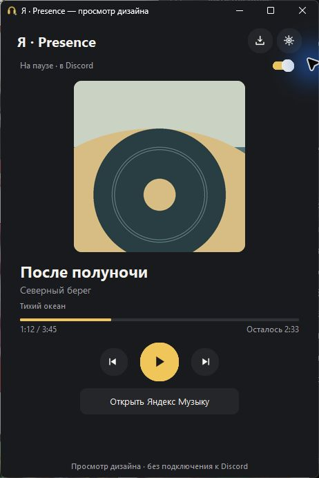
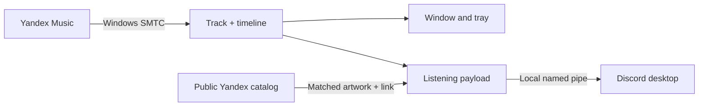

<div align="center">


**[English](README.md) · [Русский](README.ru.md)**

Your Yandex Music, visible on Discord. A small Windows companion with accurate playback timing, album art and a quiet place in the system tray.

[](https://github.com/Xijk666/YandexMusicPresence/actions/workflows/windows.yml)
[](https://github.com/Xijk666/YandexMusicPresence/releases/latest)
[](https://github.com/Xijk666/YandexMusicPresence/releases)
[](LICENSE)


**[Download EXE](https://github.com/Xijk666/YandexMusicPresence/releases/latest/download/YandexMusicPresence.exe)** · [Portable ZIP & checksums](https://github.com/Xijk666/YandexMusicPresence/releases/latest) · [Report an issue](https://github.com/Xijk666/YandexMusicPresence/issues/new/choose)

</div>

## What it does

| In the player | On Discord |
| --- | --- |
| A song is playing | Listening activity, title, artist, artwork, album tooltip and a native progress bar |
| Pause | The card stays Listening; the fixed position appears as `⏸ Пауза · 0:20 / 7:14 · Artist` |
| Seek or resume | Timing is recalculated from the Windows media timeline |
| A matching public catalog entry exists | Album cover and an “Open track” button |
| The network briefly fails | Local playback data continues; artwork lookup retries |
| Discord restarts | The app reconnects automatically |

The desktop window shows **elapsed / total** and **time remaining**. Its interface is in Russian; this repository's documentation is available in English and Russian.

## Start in a minute

<div align="center">

<p><sub>The running app in isolated design preview mode. Sample artwork and track; no activity is sent to Discord.</sub></p>
</div>

1. Download **YandexMusicPresence.exe** from [Releases](https://github.com/Xijk666/YandexMusicPresence/releases/latest). Python is not needed for the EXE.
2. Open the current [Yandex Music Windows app](https://music.yandex.ru/download/) and Discord desktop.
3. Run the EXE and play a song.
4. Enable activity sharing in Discord's activity privacy settings.

The window automatically moves to the background after **8 seconds**. Open it again by double-clicking the tray icon. Closing the window normally keeps the app in the tray; choose **Exit / Выйти** in the tray menu for a full shutdown.

Optional Windows startup and automatic background behavior are configurable in **Settings / Настройки**. Windows startup is off by default.

> Requires Windows x64. The Windows media-session API is available from Windows 10 1809; use a current Yandex Music desktop build. The old Microsoft Store 4.x player can omit timeline data and is excluded by default.

## Designed around the actual player

- **Windows media sessions:** track details and timing come from SMTC/WinRT.
- **No guessed seconds:** missing timeline data is shown as `—:—`; catalog duration never invents a playback position.
- **Pause stays musical:** the activity remains Listening, including while a game is running.
- **Careful artwork matching:** title, version, artists, album when available, and duration must match. Different artist order is supported.
- **Better artwork recovery:** fall back to the matched album's cover, try a second public API address, and retry missing images.
- **Quiet operation:** tray controls, an optional startup setting and bounded technical logs.

If several exact matches share the same cover, that common image can be displayed without selecting an arbitrary track link. Different covers remain ambiguous.

## Repository statistics

These badges read GitHub data and update independently. A new repository starts with small or zero counts.

[](https://github.com/Xijk666/YandexMusicPresence/stargazers)
[](https://github.com/Xijk666/YandexMusicPresence/forks)
[](https://github.com/Xijk666/YandexMusicPresence/watchers)
[](https://github.com/Xijk666/YandexMusicPresence/graphs/contributors)

[](https://github.com/Xijk666/YandexMusicPresence/issues)
[](https://github.com/Xijk666/YandexMusicPresence/issues?q=is%3Aissue+is%3Aclosed)
[](https://github.com/Xijk666/YandexMusicPresence/pulls)
[](https://github.com/Xijk666/YandexMusicPresence/commits/main)
[](https://github.com/Xijk666/YandexMusicPresence)

| Engineering detail | Current design |
| --- | --- |
| Regression suite | **36 tests** — timeline, catalog/artwork, payloads and local IPC |
| Media polling | About **0.5 s** |
| Metadata refresh | Events + a **2 s** control poll |
| Discord updates | At least **3 s** apart; refresh every **15 s** |
| Reconnect attempts | Every **5 s** |
| Artwork retries | **5 → 10 → 20 → 40 → 60 s**, then once a minute |
| Build | Python **3.12**, PyInstaller, one Windows x64 EXE |
| CI | Windows test run, EXE build, ZIP and SHA-256 artifact |

The workflow badge reports the latest CI result. The test count describes the present suite; it is not a code coverage percentage.

## How it works



Catalog requests use `api.music.yandex.ru` with `api.music.yandex.net` as a fallback. Public cover URLs stay on Yandex's image hosts. Local images are not uploaded to an external image host.

## Build from source

Use Windows x64 and Python 3.12:

```powershell
git clone https://github.com/Xijk666/YandexMusicPresence.git
cd YandexMusicPresence
./build.ps1
```

The script creates `.venv`, installs the pinned dependencies, runs the tests and produces `build/dist/YandexMusicPresence.exe`.

```powershell
.venv/Scripts/python.exe -m unittest discover -s tests -v
python scripts/check_project.py
.venv/Scripts/python.exe scripts/check_ui.py
.venv/Scripts/python.exe scripts/package_release.py --exe build/dist/YandexMusicPresence.exe --version 1.1.0 --out build/release
```

| Path | Purpose |
| --- | --- |
| `src/media.py` | Read-only Windows media-session source |
| `src/core.py` | Timeline calculations and Discord payload |
| `src/catalog.py` | Metadata matching and artwork lookup |
| `src/discord_ipc.py` | Framed named-pipe transport, timeouts, PING/PONG and ACKs |
| `src/engine.py` | Playback loop, retries and reconnects |
| `src/app.py` | Russian desktop UI and tray |
| `src/interface.py` | Compact player, settings, controls and diagnostics |
| `tests/` | Regression suite with isolated IPC and mocked HTTP |
| `scripts/` | Project validation and release packaging |

See [validation notes](docs/TESTING.md), [contributing](CONTRIBUTING.md) and the [changelog](CHANGELOG.md).

## Privacy and limitations

Settings, the current status and bounded logs live in `%LOCALAPPDATA%/YandexMusicPresence/`. Windows startup uses a single per-user Run registry value. The app does not require Yandex or Discord account tokens, capture audio, or use the microphone. When online artwork lookup is enabled, the title and artist are sent to Yandex's public catalog; the activity is sent to the local Discord client.

Discord controls the card's appearance. Some clients show a small `0:00` when paused without timestamps; the true paused position is in the pause text. Missing system timeline data, crossfade, ads or future player changes may limit what can be shown. An IPC acknowledgement confirms receipt by the local Discord client, not visibility to friends. This is Rich Presence; synchronized listening and Spotify integration are not implemented. Release EXEs are not code-signed.

If a card is missing, check Discord activity privacy, invisible mode, the selected media source and competing Rich Presence clients. If artwork is missing, enable online lookup and allow time for a retry. Include a track name and relevant diagnostic text in an issue.

## Credits and license

Maintained by [Xijk666](https://github.com/Xijk666). Original application code is [MIT licensed](LICENSE).

Inspired by [FozerG/WinYandexMusicRPC](https://github.com/FozerG/WinYandexMusicRPC). The default public Discord Application ID `1269826362399522849` and the external Playing/Paused images belong to that separate project; its MIT notice is included. A custom Application ID can be entered in Settings. A user token, bot token or client secret is not needed.

This is an independent project, not an official Yandex or Discord product. See [third-party notices](THIRD_PARTY_NOTICES.md) and [component licenses](licenses/). The headphone logo was created for this project with AI assistance.
