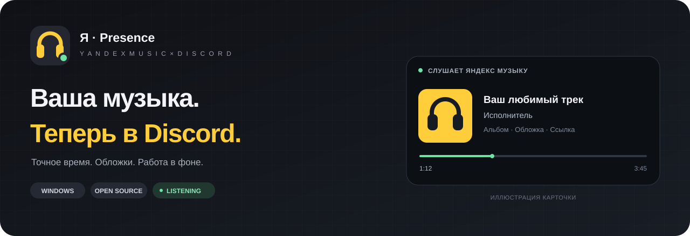
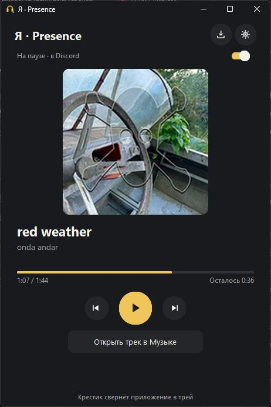
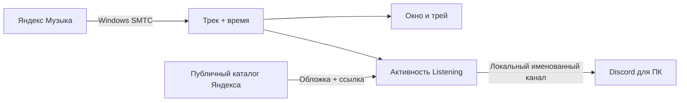

<div align="center">



**[English](README.md) · [Русский](README.ru.md)**

Ваша Яндекс Музыка в Discord: точное время трека, обложка альбома и простое приложение, которое работает в трее.

[](https://github.com/Xijk666/YandexMusicPresence/actions/workflows/windows.yml)
[](https://github.com/Xijk666/YandexMusicPresence/releases/latest)
[](https://github.com/Xijk666/YandexMusicPresence/releases)
[](LICENSE)


**[Скачать EXE](https://github.com/Xijk666/YandexMusicPresence/releases/latest/download/YandexMusicPresence.exe)** · [Архив и контрольные суммы](https://github.com/Xijk666/YandexMusicPresence/releases/latest) · [Сообщить об ошибке](https://github.com/Xijk666/YandexMusicPresence/issues/new/choose)

</div>

## Что умеет

| В плеере | В Discord |
| --- | --- |
| Играет песня | Активность Listening, название, исполнитель, обложка, альбом при наведении и штатная полоса времени |
| Пауза | Карточка остаётся Listening; фиксированная позиция — в строке `⏸ Пауза · 0:20 / 7:14 · Исполнитель` |
| Перемотка или возобновление | Время пересчитывается по системной шкале Windows |
| Найдено точное совпадение в публичном каталоге | Обложка альбома и кнопка «Открыть трек» |
| Кратковременно пропала сеть | Данные плеера продолжают считываться; поиск обложки повторяется |
| Discord перезапущен | Приложение переподключается автоматически |

В собственном окне показаны **прослушано / всего** и **оставшееся время**. Интерфейс приложения — русский; документация — на русском и английском.

## Быстрый запуск

<div align="center">

<p><sub>Настоящий снимок приложения Windows, подключённого к Яндекс Музыке и Discord.</sub></p>
</div>

1. Скачайте **YandexMusicPresence.exe** из [релизов](https://github.com/Xijk666/YandexMusicPresence/releases/latest). Для готового EXE Python не нужен.
2. Откройте современное [приложение Яндекс Музыки для Windows](https://music.yandex.ru/download/) и Discord для ПК.
3. Запустите EXE и включите песню.
4. Разрешите показ активности в настройках конфиденциальности активности Discord.

Через **8 секунд** окно автоматически уходит в фон. Двойной щелчок по значку в трее возвращает его. Крестик обычно сворачивает окно; для полного завершения выберите **«Выйти»** в меню значка.

Автозапуск Windows и автоматический уход в фон настраиваются во вкладке **«Настройки»**. Автозапуск Windows по умолчанию выключен.

> Нужна Windows x64. Системный API медиасессий доступен с Windows 10 1809; используйте актуальную версию Яндекс Музыки. Старое приложение Microsoft Store 4.x может не передавать время и по умолчанию исключено.

## Как достигается точность

- **Системная медиасессия:** название, исполнитель и время считываются через SMTC/WinRT.
- **Без выдуманных секунд:** если плеер не передал позицию, показывается `—:—`. Длительность из каталога не превращается в позицию воспроизведения.
- **Музыкальная карточка на паузе:** тип Listening сохраняется, в том числе при запущенной игре.
- **Строгое сопоставление:** проверяются название, версия, исполнители, доступный альбом и длительность. Порядок соисполнителей может отличаться.
- **Восстановление обложек:** используется обложка соответствующего альбома, резервный адрес API и повторные запросы.
- **Работа в фоне:** управление из трея, необязательный автозапуск и ограниченный технический журнал.

Если у нескольких точных совпадений одинаковый адрес обложки, можно показать общую картинку без произвольного выбора ссылки. Разные обложки считаются неоднозначностью.

## Статистика репозитория

Значки получают данные GitHub и обновляются независимо. У нового репозитория счётчики начинаются с небольших значений или нуля.

[](https://github.com/Xijk666/YandexMusicPresence/stargazers)
[](https://github.com/Xijk666/YandexMusicPresence/forks)
[](https://github.com/Xijk666/YandexMusicPresence/watchers)
[](https://github.com/Xijk666/YandexMusicPresence/graphs/contributors)

[](https://github.com/Xijk666/YandexMusicPresence/issues)
[](https://github.com/Xijk666/YandexMusicPresence/issues?q=is%3Aissue+is%3Aclosed)
[](https://github.com/Xijk666/YandexMusicPresence/pulls)
[](https://github.com/Xijk666/YandexMusicPresence/commits/main)
[](https://github.com/Xijk666/YandexMusicPresence)

| Технический показатель | Реализация |
| --- | --- |
| Автоматические проверки | **36 тестов** — время, каталог и обложки, активность, IPC |
| Опрос плеера | Примерно каждые **0,5 с** |
| Метаданные | По событию и контрольным опросом каждые **2 с** |
| Обновления Discord | Не чаще раза в **3 с**; контрольное обновление — **15 с** |
| Переподключение | Каждые **5 с** |
| Повтор поиска обложки | **5 → 10 → 20 → 40 → 60 с**, далее раз в минуту |
| Сборка | Python **3.12**, PyInstaller, один EXE Windows x64 |
| CI | Тесты Windows, сборка EXE, архив и SHA-256 |

Значок сборки отражает результат CI. Число тестов относится к текущему набору проверок; это не процент покрытия кода.

## Устройство проекта



Каталог запрашивается через `api.music.yandex.ru`, резервный адрес — `api.music.yandex.net`. Публичные обложки остаются на серверах изображений Яндекса. Локальные картинки не загружаются на сторонний хостинг.

## Сборка из исходников

Нужны Windows x64 и Python 3.12:

```powershell
git clone https://github.com/Xijk666/YandexMusicPresence.git
cd YandexMusicPresence
./build.ps1
```

Скрипт создаст `.venv`, установит зафиксированные зависимости, запустит тесты и соберёт `build/dist/YandexMusicPresence.exe`.

```powershell
.venv/Scripts/python.exe -m unittest discover -s tests -v
python scripts/check_project.py
.venv/Scripts/python.exe scripts/check_ui.py
.venv/Scripts/python.exe scripts/package_release.py --exe build/dist/YandexMusicPresence.exe --version 1.1.0 --out build/release
```

| Путь | Назначение |
| --- | --- |
| `src/media.py` | Чтение системной медиасессии Windows |
| `src/core.py` | Пересчёт времени и формат активности |
| `src/catalog.py` | Сопоставление метаданных и поиск обложек |
| `src/discord_ipc.py` | Именованные каналы, фреймы, таймауты, PING/PONG и подтверждения |
| `src/engine.py` | Рабочий цикл, повторные запросы и переподключение |
| `src/app.py` | Русский интерфейс и трей |
| `src/interface.py` | Компактный плеер, настройки, управление и диагностика |
| `tests/` | Проверки с изолированным IPC и подменёнными HTTP-ответами |
| `scripts/` | Проверка файлов и упаковка релиза |

Подробнее: [проверки](docs/TESTING.md), [участие в разработке](CONTRIBUTING.md), [история изменений](CHANGELOG.md).

## Данные и ограничения

Настройки, текущий статус и ограниченный журнал находятся в `%LOCALAPPDATA%/YandexMusicPresence/`. Для автозапуска создаётся одна запись Run текущего пользователя. Приложению не нужны токены аккаунтов Яндекса или Discord; оно не записывает аудио и не использует микрофон. Если включён поиск обложки, название и исполнитель отправляются в публичный каталог Яндекса. Активность передаётся локальному клиенту Discord.

Вид карточки определяет Discord. Некоторые клиенты на паузе без временных меток рисуют маленький `0:00`; истинная позиция находится в строке паузы. Отсутствие системного времени, плавные переходы, реклама и будущие изменения плеера могут ограничивать доступные данные. Подтверждение IPC означает, что локальный Discord принял данные, но не доказывает видимость у друзей. Это Rich Presence: совместное синхронное прослушивание и интеграция Spotify не реализованы. EXE релизов не имеют цифровой подписи.

Если карточка не видна, проверьте настройки активности Discord, невидимость, выбранный источник и другие клиенты Rich Presence. Если нет обложки, разрешите поиск в каталоге и дождитесь повторного запроса. Для сообщения об ошибке укажите песню и относящийся к проблеме текст диагностики.

## Авторство и лицензия

Автор проекта — [Xijk666](https://github.com/Xijk666). Собственный код распространяется по [лицензии MIT](LICENSE).

Источник вдохновения — [FozerG/WinYandexMusicRPC](https://github.com/FozerG/WinYandexMusicRPC). Общий Application ID Discord `1269826362399522849` и внешние изображения Playing/Paused принадлежат этому отдельному проекту; его MIT-лицензия включена. Собственный Application ID можно указать в настройках. Пользовательский токен, токен бота и Client Secret не нужны.

Проект независимый и не является официальным продуктом Яндекса или Discord. См. [сторонние компоненты](THIRD_PARTY_NOTICES.md) и [их лицензии](licenses/). Логотип с наушниками создан для проекта с помощью ИИ.
